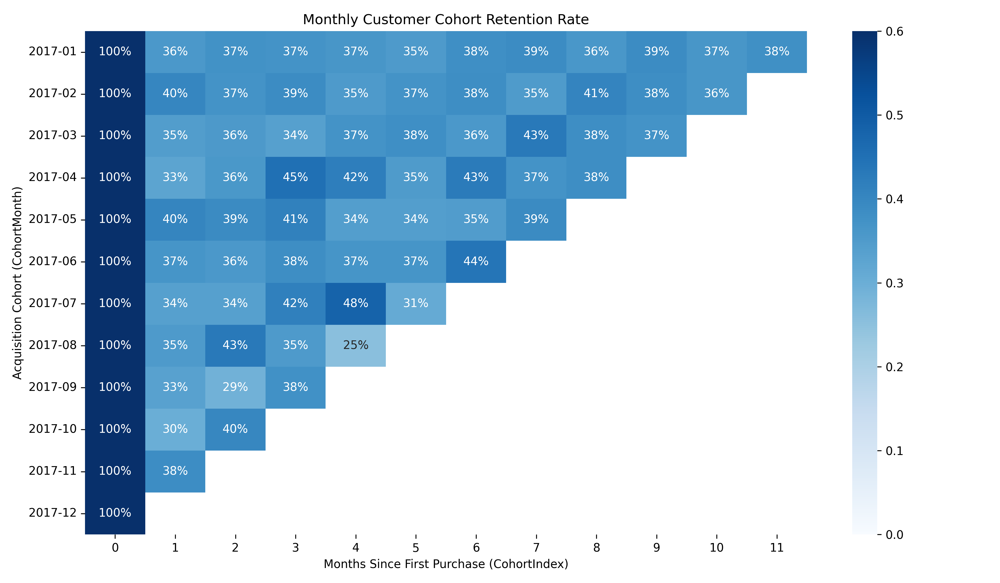

# E-Commerce Cohort Retention & Repeat-Purchase Churn Analysis

An end-to-end customer lifecycle analysis in Python on 20,000 retail transactions (`19,821` approved orders) across `3,493` unique customers (Jan–Dec 2017).

## Key Findings
- **Cohort Retention:** Month 1 retention averaged **35.6%** across monthly cohorts (ranging from **30.0%** to **40.4%**)[cite: 1].
- **90-Day Inactivity Churn:** Using >90 days without an approved purchase as a proxy churn rule resulted in a **23.1%** churn rate[cite: 1].
- **Order Frequency Impact:** Churn dropped from **69.4%** for 1-order customers to **58.8%** at 2 orders and **38.0%** at 3 orders, with order count showing the strongest negative weight in the Logistic Regression baseline (**0.722 ROC-AUC**).

## Retention Heatmap
[cite: 1, 3]